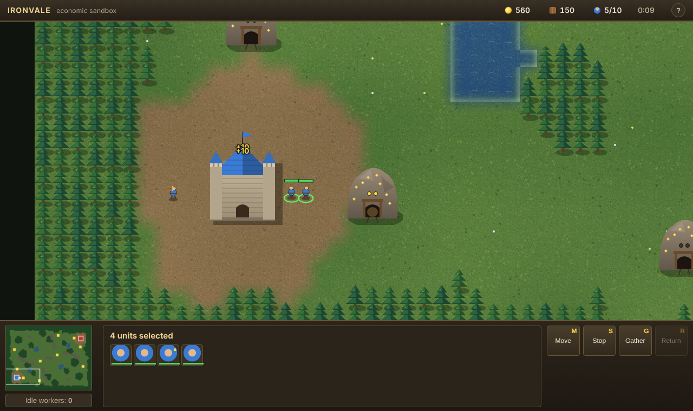

# Ironvale

An original browser real-time strategy game focused on a physical, visible
economy: workers walk to resources, gather, carry, and deliver them, and base
layout and worker allocation decide how fast you earn. Skirmish only, against
computer opponents. No campaign or story.



**Status:** Milestone 1 (economic sandbox) is done. See [Roadmap](#roadmap).

## Run it

Requires Node 20+.

```sh
npm install
npm run dev        # http://localhost:5173  (add ?seed=N for another noise seed)
npm test           # simulation tests (vitest)
npm run build      # typecheck + production bundle in dist/
```

## Controls

| Input | Action |
| --- | --- |
| Left-click / drag | Select / box-select your units |
| Shift + click / drag | Add or remove from the selection |
| Double-click a unit | Select every unit of that type on screen |
| Right-click | Context command: ground = move, mine or tree = gather, Keep = return cargo |
| M, S, G, R | Move, Stop, Gather, Return cargo (also on the command card) |
| `.` or the *Idle workers* button | Cycle through idle workers |
| Ctrl+1–9 / 1–9 | Set / recall a control group (press twice to center the camera) |
| Arrows, screen edge, middle-drag | Scroll the camera. Mouse wheel zooms. |
| Minimap | Left-click jumps the camera there. Right-click moves the selected units there. |
| Space | Jump to the latest alert, or to the current selection |
| P | Pause |
| `` ` `` / F3 | Debug overlay: blocked tiles and the selected units' paths |
| F1 / ? | Controls panel |

## Economy rules (current)

These are the rules as implemented. All numbers live in `src/sim/config.ts`.

- **Stockpiles change only on delivery.** Gathered resources stay in the
  worker's explicit `carry` (shown on its back) until it reaches a drop-off
  building. Tests check that *node + carried + stockpile* stays constant.
- **Gold:** A worker enters the mine, stays 2 s, and comes out with 10 gold.
  At most **2 workers can be inside a mine at once**. The others wait at the
  entrance, so one mine tops out at 10 gold/s, which takes about 5 workers on
  the start mine. Pips above the entrance show how many slots are in use.
- **Wood:** Each swing takes 0.6 s and yields 1 wood. A worker carries up to 10.
  A tree holds 50 wood and disappears when empty, which reopens its tile for
  walking. At most 2 workers can chop the same tree. If a worker's tree is
  felled or crowded, it looks for the nearest *reachable* tree within 12 tiles
  of where it was working.
- **Depleted mine:** The mine collapses and is removed. Each affected player
  gets a notice and a minimap ping. Its workers deliver what they carry, then
  go idle. They are not reassigned automatically.
- **Switching jobs:** A worker told to gather a different resource (or more
  gold) delivers its current load first. Stopping a worker inside a mine
  cancels that trip and yields no gold.
- **No drop-off:** If a worker has nowhere to deliver, it keeps its cargo,
  goes idle, and you get a notice.
- **Population:** Each Laborer uses 1 population, and the Keep provides 10.
  Production arrives in Milestone 2.
- **Rival:** Placeholder only. It keeps its five workers harvesting through the
  same command interface you use. The real opponent comes in Milestone 4.

## Architecture

TypeScript, Vite, and Canvas 2D. There are no runtime dependencies.

```
src/sim/      deterministic simulation (no DOM access)
  config.ts     all balance and tuning values
  types.ts      serializable GameState (plain JSON data)
  game.ts       Game: state + derived caches, entity lifecycle, fixed step()
  commands.ts   validated player commands, group-move formation slots
  gathering.ts  harvest state machine (toNode → waiting → working → toDropoff)
  movement.ts   path following, unit separation, stuck recovery
  pathfinding.ts  grid A* (8-way, no corner cutting) + line-of-sight smoothing
  nav.ts        derived passability grid, footprints, connected components
  mapgen.ts     "Twin Vales": point-symmetric 96×72 skirmish map
  rng.ts        seeded PRNG + hash/value noise
src/render/   camera, procedurally drawn placeholder art, renderer, minimap
src/input/    mouse/keyboard → selection, camera, Commands
src/ui/       DOM HUD: resources, selection panel, command card, notices
src/ai/       computer players (currently the placeholder rival)
tests/        vitest suites for simulation rules
```

Key decisions:

- **Fixed timestep.** The simulation runs at 20 ticks/s, independent of frame
  rate. The renderer interpolates unit positions between ticks. Long frame
  gaps, such as a backgrounded tab, are clamped, so the game never
  fast-forwards.
- **Commands are the only input to the simulation.** The human UI and AI both
  submit the same validated `Command` objects. A player can only command their
  own units.
- **Serializable, deterministic state.** `GameState` is plain JSON. Derived data
  (the nav grid) is rebuilt on load. The tests check that the same seed and the
  same commands produce identical state, and that a save/load mid-match then
  continues identically. This is the foundation for saves and replays.
- **Movement.** Paths are planned on the tile grid and smoothed with
  clearance-aware line-of-sight checks. Units push each other apart, with
  moving units displacing idle ones. Harvesting workers pass through other
  units, as in classic RTS games, so mining traffic doesn't jam. A unit that
  stops making progress re-plans, and units can never step into blocked
  ground.

## Research summary: why our own foundation

Before choosing a stack, I looked at standalone open-source RTS projects and
libraries. Warcraft III mods, custom maps, and anything that needs Blizzard
data were excluded.

| Project | What it is | License | Verdict |
| --- | --- | --- | --- |
| [OpenRA](https://github.com/OpenRA) | C#/SDL engine for classic Westwood RTS games | GPL-3.0; official mods need the original game files | **Ideas only.** Its trait-based actors and order system are good references. The license and the C# desktop stack don't fit a permissively licensed browser game. |
| [0 A.D. / Pyrogenesis](https://docs.wildfiregames.com/pyrogenesis/md__home_docker_jenkins_workspace_technical_docs_LICENSE.html) | C++ RTS with JS gameplay scripts, gather/build economy | Code GPL-2.0+, art CC BY-SA 3.0 | **Ideas only.** Its gatherer, drop-off and formation designs are a useful reference. GPL code and share-alike art would bind our distribution. |
| Glest / MegaGlest, Warzone 2100, Spring/Recoil | Desktop RTS engines | GPL family | Same as above: reference only. |
| [OpenFrontIO](https://github.com/unique-coder-124/OpenFrontIO) | TypeScript browser RTS | (not adopted) | Territory-control design with no worker economy. Not relevant. |
| SC_Js | Canvas StarCraft clone | Relies on copyrighted assets (removed) | **Excluded.** |
| [Recast/Detour](https://salsa.debian.org/games-team/recastnavigation/-/blob/master/License.txt) | Navmesh library | zlib | Permissive, but it's a C++ 3D navmesh tool and too heavy for a tile RTS. **Not needed.** |
| PixiJS | WebGL 2D renderer | MIT | A candidate for **later adoption** if Canvas 2D becomes a bottleneck with large armies. Not needed yet. |

Decision: write our own small foundation. The whole simulation is
under 2,000 lines of focused code. Owning it keeps determinism,
serialization, and the separation of simulation, rendering, input and AI
under our control. No third-party code or assets are included, so there are
no attribution or copyleft obligations. Everything visual is drawn
procedurally in `src/render/art.ts`. Dev dependencies (Vite, Vitest,
TypeScript) are MIT or Apache-2.0 and don't ship in the bundle.

## Verification

- **Automated (`npm test`):** pathfinding (detours, enclosed goals, no corner
  cutting); units never standing on blocked ground; group moves ending on
  distinct spots; resource conservation; mine slot limits and the throughput
  cap; mine and tree depletion with retargeting; unreachable trees being
  skipped; command ownership; map symmetry and reachability; determinism;
  save/load continuity; a 4-minute, 40-worker stress run that checks for
  stalled workers.
- **Scripted browser checks (Playwright, headless Chromium):** box and click
  selection, double-click, control groups, right-click gather, M-targeted
  move, the idle-worker hotkey, the depletion notice and idle count,
  delivery pop-ups, the debug overlay, and no console errors.
- **Not yet done:** human playtesting of feel and pacing, and frame-rate
  measurement on real hardware (headless Chromium has no GPU).

## Roadmap

1. ~~Economic sandbox~~ (done)
2. Base construction and production: placement preview, worker construction,
   costs and times, production queues and cancellation, Farms, Lumber Mill
   drop-offs
3. Combat foundation: melee and ranged units, attack and attack-move,
   auto-targeting, destruction
4. Complete skirmish: computer opponent, expansion, victory, defeat,
   surrender, restart
5. Strategic depth: hero, experience, abilities, neutral camps, fog of war,
   upgrades
