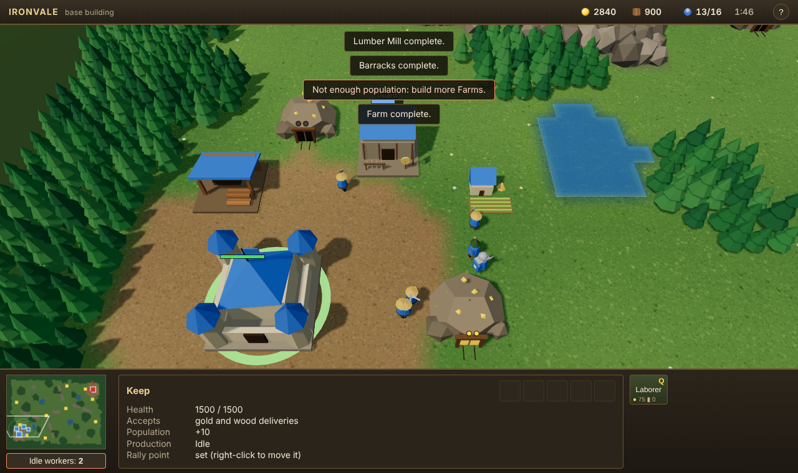

# Ironvale

An original browser real-time strategy game focused on a physical, visible
economy: workers walk to resources, gather, carry, and deliver them, and base
layout and worker allocation decide how fast you earn. Skirmish only, against
computer opponents. No campaign or story.



**Status:** These milestones are done:

- 1: economic sandbox
- 1.5: 3D foundation
- 2: base construction and production
- 3: combat foundation
- 4: complete skirmish against a computer opponent
- 5: strategic depth (fog of war, upgrades and tech, a hero, rewarding camps)

See [Roadmap](#roadmap).

## Run it

Requires Node 20+.

```sh
npm install
npm run dev        # http://localhost:5173
                   # optional: ?difficulty=easy|normal|hard&seed=N&start=1 (skip the start screen)
npm test           # simulation tests (vitest)
npm run build      # typecheck + production bundle in dist/
```

## Controls

| Input | Action |
| --- | --- |
| Left-click / drag | Select / box-select your units |
| Shift + click / drag | Add or remove from the selection |
| Double-click a unit | Select every unit of that type on screen |
| Right-click | Context command: ground = move, enemy = attack, mine or tree = gather, Keep = return cargo, unfinished building = resume construction |
| M, S, G, R | Move, Stop, Gather, Return cargo (also on the command card) |
| A, then click | Click an enemy to attack it, or the ground to attack-move: walk there and fight anything on the way |
| H | Hold position: never move, and fight whatever comes within weapon range |
| F, L, B, T, V, N, K (Laborer selected) | Place a Farm, Lumber Mill, Barracks, Watch Tower, Hall of Valor, Blacksmith or Keep. Click to place, Shift+click to keep placing, right-click or Esc to cancel. |
| Q, W (building selected) | Train or research what that building offers (Keep: Laborer / Castle · Barracks: Guard / Archer · Hall: hero · Blacksmith: weapons / armor · Lumber Mill: Bow Saws) |
| F2 or the Hero button | Select your hero |
| Q, W, E (hero selected) | Stormhammer (click an enemy), Battle Cry, Mend (click one of your units) |
| Right-click (Keep or Barracks selected) | Set the rally point. On a mine or tree, newly trained Laborers start gathering there. |
| Click a queue slot | Cancel that unit (full refund) |
| X | Cancel construction (75% refund), or the last queued unit (full refund) |
| `.` or the *Idle workers* button | Cycle through idle workers |
| Ctrl+1–9 / 1–9 | Set / recall a control group (press twice to center the camera) |
| Arrows, screen edge, middle-drag | Pan the camera. The mouse wheel zooms toward the cursor, and the camera tilts flatter as you zoom in. |
| Minimap | Left-click jumps the camera there. Right-click moves the selected units there. |
| Space | Jump to the latest alert, or to the current selection |
| P | Pause |
| F10 or the Menu button | Menu: resume, restart, new match, surrender (pauses the game) |
| `` ` `` / F3 | Debug overlay: blocked tiles (red) and the selected units' paths |
| F1 / ? | Controls panel |

## Economy rules (current)

These are the rules as implemented. All numbers live in `src/sim/config.ts`.

- **Stockpiles change only on delivery.** Gathered resources stay in the
  worker's explicit `carry` (shown on its back) until it reaches a drop-off
  building. Tests check that *node + carried + stockpile* stays constant.
- **Gold:** A worker enters the mine, stays 2 s, and comes out with 10 gold.
  At most **2 workers can be inside a mine at once**. The others wait at the
  entrance, so one mine tops out at 10 gold/s, which takes about 5 workers on
  the start mine. Pips above the entrance show how many slots are in use.
- **Wood:** Each swing takes 0.6 s and yields 1 wood. A worker carries up to 10.
  A tree holds 50 wood and disappears when empty, which reopens its tile for
  walking. At most 2 workers can chop the same tree. If a worker's tree is
  felled or crowded, it looks for the nearest *reachable* tree within 12 tiles
  of where it was working.
- **Depleted mine:** The mine collapses and is removed. Each affected player
  gets a notice and a minimap ping. Its workers deliver what they carry, then
  go idle. They are not reassigned automatically.
- **Switching jobs:** A worker told to gather a different resource (or more
  gold) delivers its current load first. Stopping a worker inside a mine
  cancels that trip and yields no gold.
- **No drop-off:** If a worker has nowhere to deliver, it keeps its cargo,
  goes idle, and you get a notice.
- **Population:** Laborers use 1 population, and Guards and Archers use 2. A
  completed Keep provides 10 and a completed Farm 6, up to a cap of 100.

## Match rules

- **Defeat:** you lose when you own no buildings at all; unfinished ones still
  count. Surrendering (F10 → Surrender) also loses at once. A defeated
  player's remaining units leave the field.
- **Victory:** you win when you are the last player not defeated.
- **Draw:** if the last players are all defeated in the same simulation tick,
  the match is a draw.
- **Neutrals:** the Brigand camps never win or lose.
- **After the outcome:** the result is final. The game keeps running behind
  the end screen, so you can choose "Keep watching".
- **End screen:** compares gold and wood gathered, units trained and lost,
  enemies destroyed, and buildings built and lost.

## Computer opponent

`src/ai/computer.ts`; profiles in `CONFIG.ai`.

- **Same rules as you.** It acts only through the same commands you use. It
  pays the same costs, has the same population limits and build times, and
  gets no extra resources. It plays under the same fog of war. It knows:
  - enemy units it currently sees;
  - enemy buildings it has seen;
  - camps it has spotted;
  - the public start locations.

  When it knows of no enemy building, its waves search start locations and
  mine sites.
- **Heroes and upgrades:**
  - It builds a Hall of Valor after its first Barracks, then trains its hero
    and revives it when it falls.
  - In fights the hero heals the most wounded ally with Mend, stuns the enemy
    hero (or the toughest fighter) with Stormhammer, and uses Battle Cry when
    3 or more allies are close.
  - Between attacks, Normal and Hard take the army and hero to clear camps on
    their own half of the map for experience and bounty.
  - Normal and Hard build a Blacksmith. They research Forged Blades, Studded
    Armor and Bow Saws, then fortify to a Castle (Normal at 12:00, Hard at
    9:00) and research the tier II upgrades.
- **Economy:**
  - About 5 Laborers per mine next to one of its Keeps, plus a small wood
    crew that shrinks when wood is plentiful.
  - Rally points send new Laborers straight to work, and idle ones are put
    back to work.
- **Building:** it plans one building at a time, in this priority order:
  1. Farms, kept ahead of its population needs
  2. Barracks
  3. Lumber Mill, next to the nearest forest
  4. Watch Tower
  5. A second Barracks
  6. An expansion Keep at the nearest unguarded mine
- **Placing buildings:** it keeps the lanes between Keeps and mines clear. It
  sets aside money for builders still walking to their sites, and puts a new
  builder on any foundation that was left unfinished.
- **Army:** a mix of Guards and Archers gathers at a staging point in front of
  its base.
  - **Defending:** it attack-moves its army toward any enemy near its
    buildings, recalling an attack wave if the threat is large. On Normal and
    Hard, nearby Laborers fight back when no soldiers are close.
  - **Attacking:** once its army reaches the wave size, it attack-moves on
    your nearest building. On Normal and Hard it first checks that it is
    stronger than your army; it attacks regardless once its army reaches 24
    units. A wave falls back at 35% strength, and the next wave is larger.
- **Difficulty** changes only decisions, never rules:

  | | Easy | Normal | Hard |
  | --- | --- | --- | --- |
  | Thinks every | 2 s | 1 s | 0.5 s |
  | Laborers per Keep (max) | 11 | 12 | 13 |
  | Barracks | 1 | 2 | 2 |
  | First attack / wave size | 9:00, 4 | 6:40, 6 | 5:00, 7 |
  | Expands at | 15:00 | 10:00 | 7:00 |
  | Checks strength before attacking | no | yes | yes |

  It also expands early if gold is the bottleneck, or if its home mine runs
  low.

## Construction rules (current)

One construction model applies throughout:

1. **Placement.** The footprint snaps to the tiles centered under the cursor.
   It is valid only if every tile is inside the map and free of terrain,
   buildings, mines and trees. Units do not block placement. The preview shows
   a ghost of the building plus a green or red marker on each tile, and the
   ghost turns red if you can't afford the building.
2. **Ordering.** The nearest selected Laborer walks to the site. Nothing is
   paid yet. An order that is invalid when given is rejected immediately, with
   a reason.
3. **Foundation.** When the Laborer arrives, placement and cost are checked
   again. If both pass, the cost is paid and the foundation appears at 10% HP.
   Any units on the footprint are pushed to the nearest free ground, so a
   building can never trap a unit inside it. If either check fails, the order
   ends and you're told why.
4. **Building.** One active builder raises the building, and both HP and
   progress grow over the build time. Extra Laborers sent to the site stand
   by and take over if the builder leaves, so they don't speed it up. If the
   builder is given another order, construction pauses. To resume, right-click
   the foundation with any Laborer.
5. **Completion.** The building starts working: it adds population and starts
   accepting deliveries. The builder goes back to whatever it was gathering
   before.
6. **Cancel.** Cancelling an unfinished building refunds 75% of its cost and
   frees its tiles.

Unfinished buildings provide no population and accept no deliveries. A
Lumber Mill built next to a forest shortens wood trips; in the tests it
raises one woodcutter's output by more than 50% on a distant tree line.

## Production rules (current)

These rules apply the same way to every player, including the computer.
All numbers are in `CONFIG.units` and `CONFIG.production`.

| Unit | Trained at | Cost | Pop | Time | Requires |
| --- | --- | --- | --- | --- | --- |
| Laborer | Keep | 75 gold | 1 | 15 s | — |
| Guard (melee) | Barracks | 135 gold | 2 | 20 s | — |
| Archer (ranged) | Barracks | 130 gold, 10 wood | 2 | 18 s | Lumber Mill |

- **Cost is paid when you queue a unit.** If you can't afford it, the unit
  isn't queued and you're told why. The same happens if the building is
  unfinished, a requirement is missing, or the queue is full (5 per
  building).
- **Population is reserved when training starts**, not when you queue.
  Training starts when a unit reaches the front of the queue. If there isn't
  enough capacity, the unit waits at 0% with a "Need Farms" marker, and you
  get one notice. Nothing is lost, and training starts by itself once
  capacity frees up.
- **Cancelling** any queued or in-progress unit refunds 100% of its cost and
  releases any population it reserved.
- **If a production building is destroyed**, its whole queue is refunded.
  Only the building itself is lost. If it was unfinished, its construction
  cost is lost too.
- **If capacity falls below usage**, for example when a Farm is lost, your
  existing units are kept. New training can't start until usage is back
  under capacity. A unit already in training keeps its reserved population
  and finishes.
- **Spawning and rally:** a finished unit appears on the free tile beside the
  building that is closest to the rally point, then walks to the rally
  point. If the rally point is a resource, a new Laborer gathers from it.
  If the building is completely boxed in, the finished unit waits at 100%
  until a tile frees up.

## Combat rules (current)

All numbers are in `CONFIG.units[*].attack`, `CONFIG.combat` and
`CONFIG.buildings.tower`.

| | HP | Armor | Damage | Every | Range | Notes |
| --- | --- | --- | --- | --- | --- | --- |
| Laborer | 220 | 0 | 6 | 1.6 s | melee | Fights only when ordered |
| Guard | 420 | 2 | 14 | 1.3 s | melee | |
| Archer | 260 | 0 | 13 | 1.5 s | 5.5 | Projectile |
| Watch Tower | 500 | 5 | 16 | 1.2 s | 7 | 110 gold, 80 wood. Fires only once finished. |
| Brigand (neutral) | 300 | 1 | 11 | 1.4 s | melee | |
| Poacher (neutral) | 200 | 0 | 10 | 1.7 s | 5 | Projectile |

- **Damage** is `damage / (1 + 0.06 × armor)`, rounded and at least 1.
  Buildings have 5 armor. Melee hits land at the end of a short wind-up.
  Ranged attacks launch a homing projectile, which is part of the
  simulation state. It deals damage when it arrives and fizzles if the
  target dies or goes into a mine first.
- **Orders:**
  - **Attack** chases its target until it dies.
  - **Attack-move** walks to a point, fights anything met on the way, then
    carries on.
  - **Hold position** never moves, and held units can't be pushed aside.
  - **Move** ignores enemies, which is how you retreat.
  - **Stop** clears the current order.
- **Automatic behavior:**
  - Idle soldiers attack enemies that come within their acquire range:
    6 tiles for Guards, 7 for Archers.
  - Units that are shot from out of sight fight back.
  - Units that engaged on their own give up and walk back after chasing
    8 tiles from where they started. Camp guards give up after 6.
  - Targets are prioritized in this order: units that can fight, then other
    units, then buildings. Within a tier, the nearest is chosen.
- **Death and destruction:** a unit at 0 HP dies, and its cargo is lost.
  A building at 0 HP collapses and frees its tiles, and its training queue
  is refunded. If it was unfinished, its construction cost is lost. Units
  inside a gold mine can't be targeted.
- **Neutral camps:** hostile camps guard the richer mines, mirror-symmetric
  on both halves of the map:
  - **Contested centre mines:** a Brigand Chief, a Brigand and a Poacher,
    worth 105 gold in bounty and 160 hero experience.
  - **Far expansions:** a Brigand and a Poacher.

  Camps stay home until you come near, so expanding there means clearing
  them first. Killing a camp unit pays its bounty, and your hero earns its
  experience if within 12 tiles. The nearby natural expansion is
  unguarded.
- **Alerts:** when any of your units or buildings is hit, you get "under
  attack" notices with a red minimap ping. They are throttled to one per
  10 s unless the attack is somewhere else. Space jumps to the latest alert.
  In fights, health bars show on every wounded unit.

## Fog of war

- **What you see:** each unit and building sees a circle around it. Sight
  ranges in tiles: Laborer 8, Guard 8, Archer 9, hero 10, Keep 10, Watch
  Tower 11, most other buildings 7. A building under construction sees only
  4.
- **Three states on the map:**
  - **Visible:** what you see right now.
  - **Explored:** ground you have seen before, drawn dimmed.
  - **Unexplored:** black.

  The minimap shows the same.
- **What fog hides:** enemy units are shown only while you can see them.
  Enemy buildings stay shown, and attackable, once you have seen them.
- **The same rules for everyone:** auto-targeting, towers and attack orders
  only work on what the owner can see. A unit ordered to chase a target out
  of sight runs to where it was last seen, and picks the chase back up if it
  spots it again.
- **Saved state:** explored ground is part of the saved game. Visibility is
  recomputed every tick, so a loaded game continues exactly.
- **Watching after the match** lifts the fog. `?fog=0` disables it for
  debugging.

## Upgrades and tech

Research shares the building's training queue, under the same rules: paid
when queued, full refund on cancel, refunded if the building is destroyed. It
is permanent and player-wide, even if the building is later lost.

| Research | At | Cost | Time | Effect | Requires |
| --- | --- | --- | --- | --- | --- |
| Forged Blades | Blacksmith | 100 gold, 50 wood | 40 s | +2 damage: Guards, Archers, hero | — |
| Tempered Blades | Blacksmith | 175 gold, 100 wood | 55 s | another +2 damage | Forged Blades, Castle |
| Studded Armor | Blacksmith | 100 gold, 50 wood | 40 s | +2 armor: Guards, Archers, hero | — |
| Plate Armor | Blacksmith | 175 gold, 100 wood | 55 s | another +2 armor | Studded Armor, Castle |
| Bow Saws | Lumber Mill | 75 gold, 50 wood | 30 s | Laborers carry 15 wood instead of 10 | — |
| Fortify to Castle | Keep | 300 gold, 200 wood | 60 s | that Keep gets +500 HP; unlocks tier II | — |

The Blacksmith (hotkey N) costs 140 gold and 60 wood.

## Hero

- **Training:** the Marshal is trained at the Hall of Valor (hotkey V; 180
  gold, 50 wood). The hero costs 250 gold and 50 wood and uses 3 population.
  You can have only one, counting a hero in training or one waiting to be
  revived.
- **Experience:** when you kill an enemy unit, your hero gains its
  experience if it is within 12 tiles. The experience is split if several
  heroes are close.

  | Kill | Experience |
  | --- | --- |
  | Laborer | 15 |
  | Guard or Archer | 35 |
  | Brigand | 40 |
  | Poacher | 30 |
  | Brigand Chief | 90 |
  | Enemy hero | 60 × its level |

  Levels need 200, 500, 900 and 1400 total experience, up to level 5.
- **Each level adds** +60 health, +3 damage, +0.5 armor and +30 maximum mana.
  Mana regenerates at 0.6 per second. Abilities get stronger at levels 3 and
  5.

  | Ability | Key | Learned | Mana / cooldown | Effect (rank I / II / III) |
  | --- | --- | --- | --- | --- |
  | Stormhammer | Q, click an enemy | level 1 | 75 / 10 s | Thrown hammer: 90 / 140 / 190 damage and a 1.5 / 2 / 2.5 s stun |
  | Battle Cry | W | level 2 | 60 / 30 s | Your units within 8 tiles deal +15 / 25 / 35% damage for 12 s |
  | Mend | E, click one of your units | level 3 | 50 / 8 s | Heals 150 / 225 / 300 |

  The hero walks into range before casting. A stunned unit can't move,
  attack or cast, and stunning a unit interrupts its swing.
- **Death and revival:** a fallen hero keeps its level and experience. Its
  Hall of Valor button becomes "Revive". Revival costs 100 + 50 × level gold
  and takes 20 + 5 × level seconds. The hero comes back at full health and
  mana. A revival does not count as a new unit in the statistics.

## Architecture

TypeScript and Vite, with three.js for 3D rendering. three.js is the only
runtime dependency.

```
src/sim/      deterministic simulation (no DOM access)
  config.ts     all balance and tuning values
  types.ts      serializable GameState (plain JSON data)
  game.ts       Game: state + derived caches, entity lifecycle, fixed step()
  commands.ts   validated player commands, group-move formation slots
  gathering.ts  harvest state machine (toNode → waiting → working → toDropoff)
  movement.ts   path following, unit separation, stuck recovery
  pathfinding.ts  grid A* (8-way, no corner cutting) + line-of-sight smoothing
  nav.ts        derived passability grid, footprints, connected components
  mapgen.ts     "Twin Vales": point-symmetric 96×72 skirmish map
  rng.ts        seeded PRNG + hash/value noise
  construction.ts placement checks, construction model, cancel/refund
  production.ts training queues, population reservation, rally, refunds
  combat.ts     targeting, attack orders, wind-up/cooldown, projectiles, armor, death
  outcome.ts    defeat, victory, draw, surrender
  vision.ts     fog of war: per-player visibility, explored tiles, seen buildings
  tech.ts       research rules and effective damage / armor / carry
  hero.ts       experience, levels, bounty, abilities, stun and buffs
src/render3d/ three.js view (reads state, never writes it)
  cameraRig.ts  angled RTS camera; screen <-> ground conversion
  world.ts      scene, terrain props, entity views and animation, picking, previews
  models.ts     low-poly primitive models (Laborer, Keep, Farm, Mill, mine, trees)
  overlay.ts    2D overlay: health/mana/progress bars, mine pips, floating numbers
  fog.ts        fog-of-war texture injected into every lit material's shader
  groundTexture.ts  procedurally painted ground texture
src/input/    mouse/keyboard → selection, camera, placement, Commands
src/ui/       DOM HUD, command card, minimap, objectives checklist, start/menu/end screens
src/ai/       computer opponent (computer.ts) and its building placement (placement.ts)
tests/        vitest suites for simulation rules
```

Key decisions:

- **Fixed timestep.** The simulation runs at 20 ticks/s, independent of frame
  rate. The renderer interpolates unit positions between ticks. Long frame
  gaps, such as a backgrounded tab, are clamped, so the game never
  fast-forwards.
- **Commands are the only input to the simulation.** The human UI and AI both
  submit the same validated `Command` objects. A player can only command their
  own units.
- **Serializable, deterministic state.** `GameState` is plain JSON. Derived data
  (the nav grid) is rebuilt on load. The tests check that the same seed and the
  same commands produce identical state, and that a save/load mid-match then
  continues identically. This is the foundation for saves and replays.
- **3D sits on a 2D simulation.** Gameplay stays on a ground plane. A
  simulation point `(x, y)` in tiles maps to world `(X = x, Y = height,
  Z = y)`, with one world unit per tile. The renderer is a pure view:
  - **Picking** projects unit bodies to the screen and ray-casts
    buildings, mines and instanced trees. It falls back to the tile under the
    cursor.
  - **Box selection** projects each unit to the screen and tests it against
    the rectangle.
  - **Placement** converts the cursor to the ground with a ray-plane
    intersection.
- **Movement.** Paths are planned on the tile grid and smoothed with
  clearance-aware line-of-sight checks. Units push each other apart, with
  moving units displacing idle ones. Harvesting workers pass through other
  units, as in classic RTS games, so mining traffic doesn't jam. A unit that
  stops making progress re-plans, and units can never step into blocked
  ground.

## Research summary: why our own foundation

Before choosing a stack, I looked at standalone open-source RTS projects and
libraries. Warcraft III mods, custom maps, and anything that needs Blizzard
data were excluded.

| Project | What it is | License | Verdict |
| --- | --- | --- | --- |
| [OpenRA](https://github.com/OpenRA) | C#/SDL engine for classic Westwood RTS games | GPL-3.0; official mods need the original game files | **Ideas only.** Its trait-based actors and order system are good references. The license and the C# desktop stack don't fit a permissively licensed browser game. |
| [0 A.D. / Pyrogenesis](https://docs.wildfiregames.com/pyrogenesis/md__home_docker_jenkins_workspace_technical_docs_LICENSE.html) | C++ RTS with JS gameplay scripts, gather/build economy | Code GPL-2.0+, art CC BY-SA 3.0 | **Ideas only.** Its gatherer, drop-off and formation designs are a useful reference. GPL code and share-alike art would bind our distribution. |
| Glest / MegaGlest, Warzone 2100, Spring/Recoil | Desktop RTS engines | GPL family | Same as above: reference only. |
| [OpenFrontIO](https://github.com/unique-coder-124/OpenFrontIO) | TypeScript browser RTS | (not adopted) | Territory-control design with no worker economy. Not relevant. |
| SC_Js | Canvas StarCraft clone | Relies on copyrighted assets (removed) | **Excluded.** |
| [Recast/Detour](https://salsa.debian.org/games-team/recastnavigation/-/blob/master/License.txt) | Navmesh library | zlib | Permissive, but it's a C++ 3D navmesh tool and too heavy for a tile RTS. **Not needed.** |
| [three.js](https://github.com/mrdoob/three.js) | WebGL 3D library | MIT | **Adopted** (pinned to 0.179.1) for the 3D view. The MIT license only asks that its copyright notice stays with copies of the library. The bundled build keeps that notice. |
| Babylon.js | WebGL 3D engine | Apache-2.0 | A viable alternative. three.js won because it is lighter and we only need rendering, not physics or engine services. |

Decision: write our own small foundation. The whole simulation is
under 2,000 lines of focused code. Owning it keeps determinism,
serialization, and the separation of simulation, rendering, input and AI
under our control. No third-party code or assets are included, so there are
no copyleft obligations. Every model is built from primitives in
`src/render3d/models.ts`, and the ground texture is painted in code. Dev
dependencies (Vite, Vitest, TypeScript) are MIT or Apache-2.0 and don't ship
in the bundle. `npm audit` flags advisories in Vitest's dev-only internals,
which are never shipped to players.

## Verification

- **Automated (`npm test`):** pathfinding (detours, enclosed goals, no corner
  cutting); units never standing on blocked ground; group moves ending on
  distinct spots; resource conservation; mine slot limits and the throughput
  cap; mine and tree depletion with retargeting; unreachable trees being
  skipped; command ownership; map symmetry and reachability; determinism;
  save/load continuity; a 4-minute, 40-worker stress run that checks for
  stalled workers.
  - **Construction:** placement validity, pay-on-arrival, failure reasons,
    pushing units off the site, pause and resume, cancel refunds, Lumber Mill
    trip shortening, and builders returning to their job.
  - **Production:**
    - Pay-on-queue and reserve-on-start.
    - Refusals with reasons: too poor, wrong building, unfinished building,
      full queue, missing Lumber Mill.
    - Cancel refunds.
    - Waiting at the population cap and resuming once a Farm is built.
    - Capacity loss, with in-progress items keeping their reservation.
    - Destroyed-building refunds.
    - Rally onto a mine.
    - Ownership checks.
  - **Combat:**
    - Armor math.
    - Chase and kill, with the hit count matching damage and HP.
    - Attack rate matching the cooldown.
    - Projectiles that land on arrival, and that fizzle when their target dies.
    - Units in mines can't be targeted.
    - Building destruction frees tiles and refunds the queue.
    - Auto-acquire, leash and return, and fighting back.
    - Move ignoring enemies, attack-move resuming, hold never moving or
      being pushed.
    - Workers don't auto-attack, and nothing can attack allies or resources.
    - The tower fires only when finished, and melee units route around walls.
    - A 10-vs-10 brawl resolves with no stuck units.
    - Camps are symmetric, stay idle, and return home after their leash.
    - Determinism and save/load hold mid-fight.
  - **Match rules:** elimination, unfinished buildings still counting,
    same-tick draw, surrender, final outcomes, neutrals, statistics.
  - **Computer opponent:**
    - Builds a working base in 6 minutes: Keep, Farms, Barracks, Lumber
      Mill, 10+ Laborers and 5+ soldiers, with at most 2 idle workers.
    - Beats a passive player, and wipes out a raid on its Keep.
    - A full Hard-vs-Easy match ends decisively, and resources never go
      negative.
    - Deterministic.
  - **Fog of war:**
    - Sight circles, and explored ground remembered.
    - Unseen units can't be targeted, while remembered buildings can be
      attacked.
    - Ordered pursuit chases to the last-seen spot.
    - Each side starts seeing only its own base.
    - Every unit can see as far as it can acquire and shoot.
    - Save/load continues exactly with fog.
  - **Strategic depth:**
    - Research: pay on queue, effects on current and future units, tier II
      needing tier I and the Castle (which adds HP), no duplicates, cancel
      refunds, permanent after the building is lost, Bow Saws carry.
    - Hero: one per player; revived at its level for the scaled cost and
      time; experience and level-ups from nearby kills only; bounty.
    - Stormhammer: walks into range, spends mana, damages, stuns (no moving
      or attacking), cooldown enforced.
    - Battle Cry: level-gated, nearby allies only, expires.
    - Mend: heals own units only.
    - Camps include a Brigand Chief.
  - **Growth (integration):** a scripted build order on the real map, using
    only player commands, goes from 5 to 21 Laborers, builds a Farm, and
    expands with a second Keep at the nearby expansion mine, which then
    receives 200+ gold deliveries. Gold accounting is exact the whole way.
  - **Camera math:** the ground→screen→ground round trip at every zoom level,
    zoom keeping the point under the cursor fixed, and pan bounds.
- **Scripted 3D browser checks (Playwright, headless Chromium, software
  WebGL):**
  - In the 3D view: box, click, Shift and double-click selection; hover
    picking of the mine and of individual trees; right-click gather;
    placement preview on invalid and valid ground; cursor→ground accuracy
    (within 0.001 tile); a full Farm build; zoom and pan; the debug overlay;
    no console errors.
  - Production UI: train hotkeys, the queue panel with click-to-cancel, rally
    by right-click, Barracks placement, the Archer locked until a Lumber Mill
    is finished, the population-blocked notice, and Guards and Archers
    walking to the rally flag.
  - Combat:
    - Box-selecting an army, hovering an enemy, and A+click attack.
    - A 10-unit army clearing a Brigand camp with no losses.
    - Wounded health bars, toppling deaths, and hit sparks.
    - Arrows in flight from Archers and the tower.
    - Building a tower with the T hotkey, and a held Archer defending
      beside it.
    - The "base under attack" alert, with no console errors.
  - A typical scene draws in about 110 draw calls and 154k triangles.
  - The same flows were checked in 2D during Milestone 1: control groups,
    the idle-worker hotkey, and the depletion notice and idle count.
- **AI-vs-AI matches (headless, 12 games, outside the test suite):** every
  game ended decisively, at 10–20 minutes of game time and 1–2 s of real
  time per game. The stronger difficulty won most matchups:
  - Hard beat Easy 2 of 2.
  - Hard beat Normal 3 of 4.
  - Normal beat Easy 3 of 4.

  Both mirror matches went to player 0, which may be a slight seat bias to
  investigate in Phase E.
- **Scripted browser checks for Milestone 4:**
  - The start screen pauses the game, and choosing a difficulty starts that
    match.
  - The objectives checklist ticks off as you play.
  - F10 opens the menu and pauses.
  - Surrendering shows the defeat screen with the right reason and
    statistics, and "Play again" starts a new match.
  - Destroying the enemy shows the victory screen.
  - A Normal AI beat a passive player at 7:40 and showed the elimination
    screen, and "Keep watching" works.
  - No console errors.
- **AI-vs-AI with Milestone 5 (headless, outside the test suite):** in 6
  games, every one ended decisively in 15–16 minutes.
  - Hard beat Easy twice, Hard beat Normal twice, and Normal beat Easy.
  - Both AIs reached hero level 4–5, and Normal and Hard researched up to
    tier II.
  - In one Hard-vs-Normal game, both heroes cast all three abilities, fell 3
    times each and were revived, and both sides earned camp bounties.
- **Scripted browser checks for Milestone 5:**
  - Fog renders as visible, dimmed and black, on the minimap too, and a
    scout reveals the map as it moves.
  - Through the real UI: building a Hall of Valor (V) and a Blacksmith (N),
    training the hero (Q), Forged Blades (Q), Fortify to Castle (W), and
    seeing the Castle model.
  - F2 selects the hero, and Battle Cry and Mend show as locked at level 1.
  - Stormhammer is cast with Q and a click, shows its cooldown, and spends
    mana.
  - Clearing a camp gave 160 experience and 105 gold in bounty.
  - No console errors.
- **Not yet done:** human playtesting of feel and pacing, and frame-rate
  measurement on real GPUs. Software WebGL only manages ~2–3 fps, which says
  nothing about real hardware.

## Roadmap

1. ~~Economic sandbox~~ (done)
1.5. ~~3D foundation~~ (done): angled camera, 3D models, picking, placement
   preview. The simulation, commands and tests carried over unchanged.
2. ~~Base construction and production~~ (done)
3. ~~Combat foundation~~ (done)
4. ~~Complete skirmish~~ (done)
5. ~~Strategic depth~~ (done): fog of war, upgrades and tech, a hero with
   levels and abilities, rewarding neutral camps.

Next is the long-term roadmap, starting with Phase A: refining pathfinding
and group movement, controls, pacing and balance, informed by real
playtesting.
